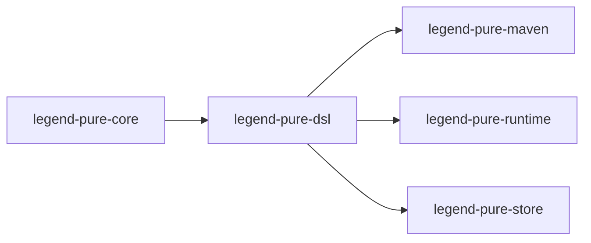
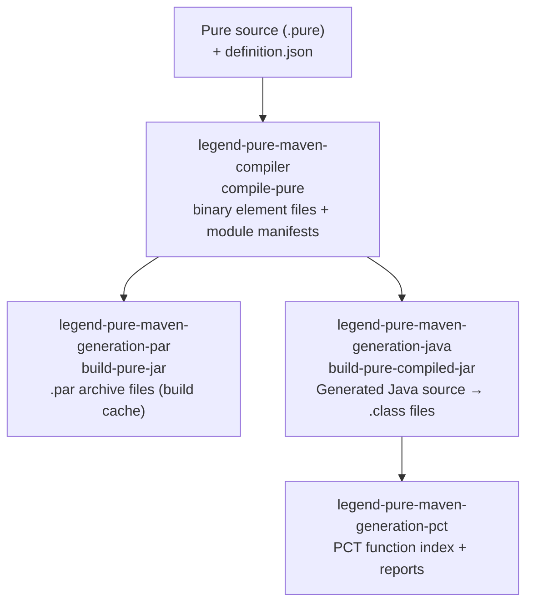

# Build & CI Guide

## 1. Full Maven Build Lifecycle

The build is driven by the root `pom.xml` at `legend-pure/pom.xml`. The module
reactor order is determined by the `<modules>` declaration and inter-module
dependencies:



### Custom Build Phases Summary

| Phase | Notable actions |
|-------|----------------|
| `initialize` | Register `target/generated-sources/` and `target/generated-test-sources/` as source roots (build-helper-maven-plugin) |
| `generate-sources` | ANTLR4 parser generation; M3 CoreInstance Java generation (`generate-m3-core-instances`); `JavaModelFactoryGenerator` for compiled runtime |
| `compile` | Standard Java compile; `compile-pure` plugin compiles Pure source to binary elements |
| `process-classes` | Second `maven-compiler-plugin` execution to compile generated sources that depended on the first compile pass |
| `process-test-classes` | PCT report generation for interpreted runtime (`exec-maven-plugin`) |
| `test-compile` | `dependency:analyze-only` validates declared vs used dependencies |
| `test` | `maven-surefire-plugin` runs JUnit 4 tests; JaCoCo collects coverage data |
| `verify` | `maven-checkstyle-plugin` checks style; JaCoCo generates HTML/XML coverage reports |
| `install` | Artifacts installed to local `~/.m2/repository` |

---

## 2. Custom Maven Plugins Deep-Dive

For the full reference — goals, configuration parameters, typical POM snippets, and
the rationale for each plugin — see the
[Maven Plugins Reference](../reference/maven-plugins-reference.md).

### How the Plugins Chain Together



### Classloader Isolation

Each Mojo constructs a `URLClassLoader` from the resolved compile-scope (or test-scope)
Maven dependencies and sets it as the thread context classloader before delegating.
This ensures the plugin sees the same classpath as the module being built, not the
Maven plugin classloader.

---

## 3. Dependency Analysis

The `maven-dependency-plugin` runs at `test-compile` with `failOnWarning=true`
and `ignoreNonCompile=true`. This means the build **fails** if:

- A compile-scope dependency is declared in `pom.xml` but not actually imported in
  any source file in that module.
- A compile-scope class is used in source but the dependency is not declared (even
  if it arrives transitively).

To debug dependency warnings:

```bash
mvn dependency:analyze -pl <module-path>
```

To see the full dependency tree:

```bash
mvn dependency:tree -pl <module-path>
```

To check for version conflicts:

```bash
mvn dependency:tree -Dverbose -pl <module-path> | grep "omitted for conflict"
```

---

## 4. Code Coverage (JaCoCo)

JaCoCo is configured in the root POM with two executions:

| Execution | Phase | Goal |
|-----------|-------|------|
| `pre-unit-test` | `test` (prepare-agent) | Instruments bytecode at test start |
| `post-unit-test` | `test` (report) | Generates HTML/XML report in `target/site/jacoco/` |

### Excluded from Coverage

The following generated-code paths are excluded:

- `org/finos/legend/pure/m4/serialization/grammar/**/*` — ANTLR4 generated parsers
- `org/finos/legend/pure/m3/serialization/grammar/**/*`
- `org/finos/legend/pure/m3/coreinstance/**/*` — Generated CoreInstance accessors
- `org/finos/legend/pure/m2/dsl/*/serialization/grammar/**/*` — DSL ANTLR4 parsers
- `org/finos/legend/pure/m2/relational/serialization/grammar/**/*`
- `org/finos/legend/pure/generated/**/*` — All generated Java from Pure

### Viewing Coverage Reports

After `mvn test`:

```bash
open legend-pure-core/legend-pure-m3-core/target/site/jacoco/index.html
```

---

## 5. GitHub Actions CI Pipeline

The pipeline is defined in [`.github/workflows/build.yml`](../../.github/workflows/build.yml).

### Trigger

Runs on pull requests, and on pushes to any branch of `finos/legend-pure`.
Pushes to forks are not built: a fork's topic branch is built as its pull
request (or on demand, with `workflow_dispatch`), and a fork's `master` only
ever syncs commits that were already built here. Tag pushes are ignored, and
the post-release version-bump commit (message starting `Bump version to`) is
skipped. A newer push to a pull request cancels the run for the older one.

### Environment

- **Runner:** `ubuntu-latest`
- **JDK:** Temurin 17
- **Maven cache:** `~/.m2/repository` keyed on `hashFiles('**/pom.xml')`

### Steps

| Step | Command |
|------|---------|
| Checkout | `actions/checkout@v6` |
| Cache Maven deps | `actions/cache@v5` |
| Setup JDK 17 | `actions/setup-java@v5` |
| Configure Git | Sets committer identity for the post-release version bump |
| Pre-fetch deps | `mvn de.qaware.maven:go-offline-maven-plugin:resolve-dependencies` |
| Build + Test (non-master) | `mvn -B -e install -DforkCount=3 -DreuseForks=true ...` |
| Build + Test + Sonar (master only) | `mvn -B -e install -Psonar ...` |
| Upload test results | Uploads `surefire-reports-aggregate/*.xml` as artifact |
| Upload CI event | Uploads `github.event_path` for `test-result.yml` (pull requests and `master` only) |

### Surefire Report Aggregation

All modules are configured with:

```text
-Dsurefire.reports.directory=${GITHUB_WORKSPACE}/surefire-reports-aggregate-jdk<N>
```

This aggregates every module's test XML into a single directory per JDK. Each
test job summarizes it on the run's summary page with
[`.github/scripts/test-summary.py`](../../.github/scripts/test-summary.py) and
uploads it as a build artifact. For pull requests, the `test-result.yml`
workflow also publishes the results as a `Test Results` check and a PR comment.
That has to be a separate workflow because a pull request from a fork gets a
read-only token. Builds of `master` get the check without a comment, since a
PR's comment compares its results against the check on its base commit.

### Developer Platforms (Windows and macOS)

[`.github/workflows/developer-platforms.yml`](../../.github/workflows/developer-platforms.yml)
checks that a developer can build and test on Windows and macOS. What ships is
built and tested on Linux, so these jobs are not part of the release pipeline
and publish nothing. The workflow runs on pull requests that are not drafts
(marking a draft ready for review starts a run) and on demand, which is how to
get a result on a fork's branch before opening a pull request.

Each platform is a single JDK 25 job: `mvn install -DskipTests`, then
`mvn surefire:test`, then the VS Code extension's unit tests. Like the Linux
test jobs, each one summarizes its test results on the run's summary page.
The Windows job
keeps the runner's default `core.autocrlf=true`, so it builds from CRLF
sources, as a Windows developer with Git's default settings does.

### Release Process

Releases are triggered by the [`release.yml`](../../.github/workflows/release.yml)
workflow. The project uses Maven CI-friendly versions: every pom's version is
`${revision}`, defined once in the root pom, and `flatten-maven-plugin` writes
the resolved version into the published poms. A release builds and deploys the
tested commit with `-Drevision=<version>`, then pushes the tag
`legend-pure-<version>` onto that commit and commits the next `-SNAPSHOT` to the
branch. There is no release commit — the tag lands on the tested commit itself.

Publishing comes before tagging. The deploy is the irreversible step and the
only one that realistically fails, so a failed release leaves nothing to clean
up and can simply be dispatched again; the tag records a release that has
already gone out. The single exception is a pom that still carries `${revision}`,
which would upload happily and cannot be withdrawn, so `flatten:flatten` runs on
its own beforehand — seconds, not minutes — and fails the release if any pom is
unresolved. A dry run additionally does a full `clean install -P release`, so a
rehearsal still catches the release-only failures (javadoc, gpg, source jars)
that ordinary CI never exercises.

Do not trigger releases manually unless you are the designated release engineer.

---

## 6. SonarCloud Integration

- **Project key:** `legend-pure`
- **Organization:** `finos`
- **Dashboard:** <https://sonarcloud.io/dashboard?id=legend-pure>
- Quality gate badges are displayed in the root `README.md`.
- The `-Psonar` profile is **only activated on `master` branch CI runs**; it is
  never needed locally.

---

*Back: [Getting Started Guide](getting-started.md) · Next: [Coding Standards](../standards/coding-standards.md)*
